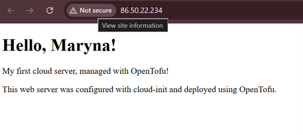
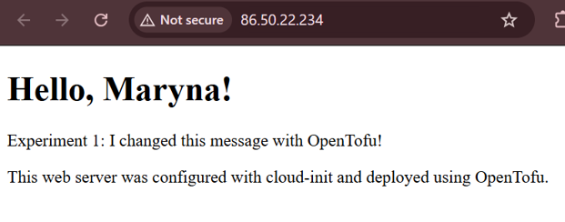
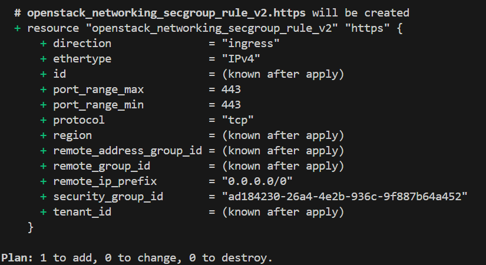
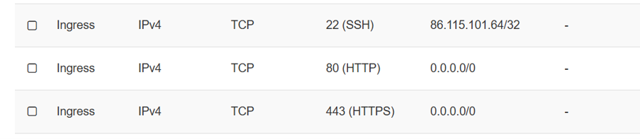
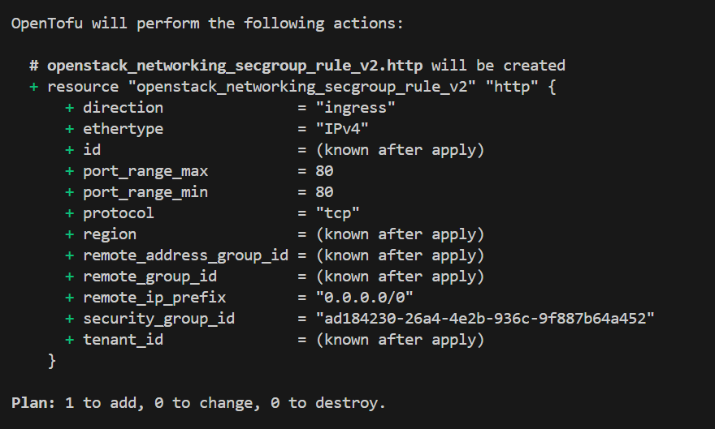
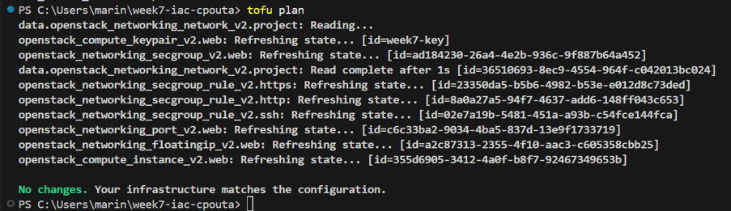
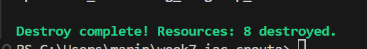
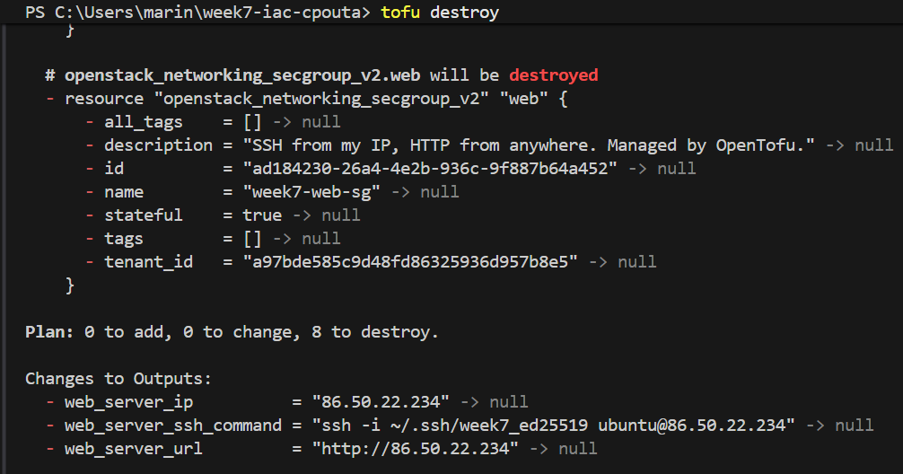
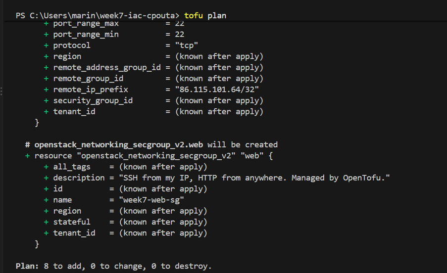
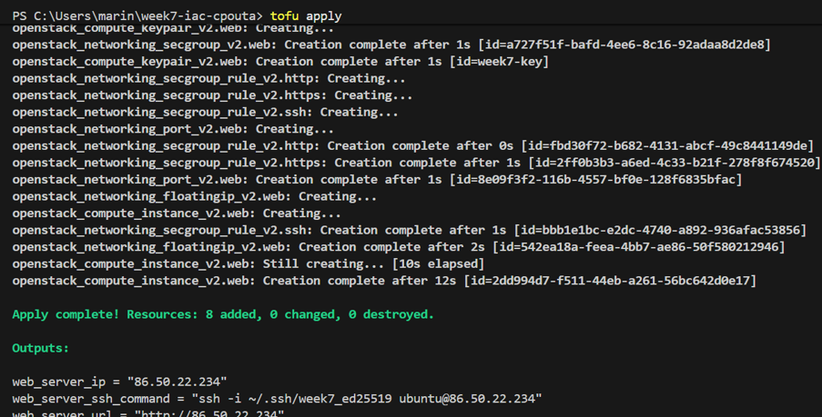

# Week 7 — Infrastructure as Code with OpenTofu

**GitHub repository:** https://github.com/Marik939/week7-iac-cpouta

This project deploys an Ubuntu web server on the CSC cPouta OpenStack cloud using OpenTofu. The configuration creates the network interface, floating IP, SSH key pair, security group and rules, and virtual machine. Cloud-init installs Apache and writes a custom web page.

## Table of contents

- [Project files](#project-files)
- [Resources and dependencies in `main.tf`](#resources-and-dependencies-in-maintf)
- [Experiment 1 — Change the page and allow HTTPS](#experiment-1--change-the-page-and-allow-https)
- [Experiment 2 — Configuration drift](#experiment-2--configuration-drift)
- [Experiment 3 — Destroy and re-create](#experiment-3--destroy-and-re-create)
- [Answers to the questions](#answers-to-the-questions)
- [Reflection: Week 1 and Week 7](#reflection-week-1-and-week-7)
- [Problems encountered and solutions](#problems-encountered-and-solutions)
- [Requirements and usage](#requirements-and-usage)
- [Security and cleanup](#security-and-cleanup)

## Project files

- **`main.tf`** — Defines the existing project network data source and the resources managed by OpenTofu: SSH key pair, security group, SSH/HTTP/HTTPS rules, network port, virtual machine and floating IP.
- **`variables.tf`** — Declares input variables such as network name, name prefix, image, flavor, SSH public key path, allowed SSH CIDR, student name and web page message.
- **`terraform.tfvars`** — Provides actual values for the variables. It contains personal configuration values and is intentionally excluded from Git.
- **`terraform.tfvars.example`** — Provides safe example values to help another user create their own `terraform.tfvars`.
- **`versions.tf`** — Declares the OpenStack provider source used by OpenTofu.
- **`outputs.tf`** — Prints the server's public IP address, website URL and SSH command after deployment.
- **`cloud-init.yaml`** — Installs Apache and creates the custom web page using the supplied student name and message.
- **`README.md`** — Documents the project, its resources, experiments, answers and usage.
- **`.gitignore`** — Excludes credentials, personal variable values, state files and generated provider files from Git.
- **`.terraform.lock.hcl`** — Records the selected provider version and checksums to support consistent provider installation.

The `.terraform` directory is generated by OpenTofu during initialization. `terraform.tfstate` and `terraform.tfstate.backup` contain infrastructure state and must not be committed. `clouds.yaml` contains OpenStack connection details and application credentials and must also remain private.

## Resources and dependencies in `main.tf`

### Existing project network data source

`data.openstack_networking_network_v2.project` looks up the existing cPouta network by the `project_network` variable. Other resources use its ID. The network is not created or managed by this configuration, so `tofu destroy` does not delete it.

### SSH key pair

`openstack_compute_keypair_v2.web` registers the public SSH key from `ssh_public_key_path` in OpenStack. The virtual machine references this key pair through `key_pair`, allowing SSH access with the matching private key.

### Security group and rules

`openstack_networking_secgroup_v2.web` creates a security group named using `name_prefix`. The following separate resources define incoming access:

- `openstack_networking_secgroup_rule_v2.ssh` — allows TCP port 22 from `ssh_allowed_cidr`.
- `openstack_networking_secgroup_rule_v2.http` — allows TCP port 80 from any IPv4 address (`0.0.0.0/0`) so the website can be reached over HTTP.
- `openstack_networking_secgroup_rule_v2.https` — allows TCP port 443 from any IPv4 address. Opening the port does not by itself configure HTTPS or install a TLS certificate.

Each rule references the security group ID, so the security group must exist before the rules can be attached.

### Network port

`openstack_networking_port_v2.web` creates a port on the existing project network. It uses the network ID from the data source and attaches the security group. The port provides the network interface used by the virtual machine and the floating IP.

### Virtual machine

`openstack_compute_instance_v2.web` creates the Ubuntu instance using `image_name` and `flavor_name`. It uses the registered key pair and connects through the network port. The `user_data` argument renders `cloud-init.yaml` with `student_name` and `page_message`; cloud-init installs Apache and creates the web page during initial setup.

### Floating IP

`openstack_networking_floatingip_v2.web` allocates a public address from the `public` pool and associates it with the network port. This makes the web server reachable outside the project network. `outputs.tf` uses this address to build the URL and SSH command.

### Dependency relationships

1. The data source reads the existing project network; the network port uses its ID.
2. The security group is created before its SSH, HTTP and HTTPS rules.
3. The network port uses the network ID and security group ID.
4. The virtual machine uses the SSH key pair and network port.
5. The floating IP is associated with the network port.
6. Outputs use the floating IP address to show the public IP, website URL and SSH command.

OpenTofu derives the dependency graph from references in the configuration. It creates dependent resources after their prerequisites and destroys resources in a dependency-aware order. Independent resources may be processed in parallel.

## Experiment 1 — Change the page and allow HTTPS

### Option A: Change the page text

**Prediction**

I predicted that changing `page_message` would cause the virtual machine to be replaced because it changes the cloud-init `user_data`. I also predicted that the public IP would remain the same because the floating IP was a separate resource attached to the network port.

**Result**

OpenTofu showed that `user_data` forces replacement. The plan summary was:

```text
Plan: 1 to add, 0 to change, 1 to destroy.
```

After applying the change, the VM was recreated and the web page displayed the updated message. The public IP remained `86.50.22.234`.





**Explanation**

Changing `page_message` changes the rendered cloud-init configuration passed to the VM through `user_data`. The OpenStack provider replaces the instance because this attribute cannot be updated in place. The floating IP resource was not replaced and remained associated with the network port, so the public IP stayed the same.

### Option B: Allow HTTPS

**Prediction**

I predicted that adding an HTTPS rule would add one resource without replacing the VM. I also predicted that opening port 443 alone would not make the page work over HTTPS because Apache still needs HTTPS configuration and a TLS certificate.

**Result**

The plan summary was:

```text
Plan: 1 to add, 0 to change, 0 to destroy.
```

OpenTofu added `openstack_networking_secgroup_rule_v2.https`. The security group then had ingress rules for TCP ports 22, 80 and 443. The VM was not replaced.




**Explanation**

Only the security group configuration changed, so OpenTofu needed to create one rule and did not need to replace the VM. Opening TCP port 443 does not automatically enable HTTPS; the web server also needs HTTPS configuration and a suitable TLS certificate.

## Experiment 2 — Configuration drift

Configuration drift occurs when actual infrastructure differs from the configuration intended to describe and manage it. I tested two manual changes in cPouta.

### Part 1: Delete the HTTP rule manually

**Prediction**

I predicted that OpenTofu would detect that the HTTP security group rule had been deleted and propose recreating it because the rule was declared in the configuration and tracked in state.

**Result**

After I manually deleted the HTTP rule in cPouta, `tofu plan` proposed creating it again:

```text
Plan: 1 to add, 0 to change, 0 to destroy.
```

After applying the plan, the rule was restored and the website worked again.



**Explanation**

The HTTP rule was declared in the OpenTofu configuration and tracked in the state file. During refresh, OpenTofu detected that the resource was missing and planned to recreate it. The VM did not need to be replaced.

### Part 2: Add a TCP 8080 rule manually

**Prediction**

I predicted that `tofu plan` would not propose removing the manually added TCP port 8080 rule because that rule was not declared as a managed resource in the configuration.

**Result**

After I manually added the TCP 8080 rule, OpenTofu reported:

```text
No changes. Your infrastructure matches the configuration.
```



**Explanation**

The manually added rule was not declared as a resource in the OpenTofu configuration, so OpenTofu did not propose removing it. Drift detection depends on which resources are managed and what the provider reports. This experiment showed why infrastructure changes should normally be made through the IaC configuration rather than directly in the cloud interface.

## Experiment 3 — Destroy and re-create

### Predictions before running OpenTofu

1. **How many resources will be destroyed? Will the project network be deleted?** I predicted that eight managed resources would be removed. The existing project network would not be deleted because it is referenced through a data source rather than managed as a resource.
2. **In which order will resources be destroyed?** I predicted that OpenTofu would destroy resources in reverse dependency order. Dependent resources would be removed before resources they depend on, although independent resources could be destroyed in parallel.
3. **Will the public IP be the same after recreation?** I predicted that the address might change because the floating IP would be released and allocated again.

### Destroy result

`tofu destroy` completed successfully:

```text
Destroy complete! Resources: 8 destroyed.
```

The eight managed resources were the virtual machine, SSH key pair, floating IP, network port, security group and three security group rules. The existing project network was not deleted.




### Plan after destruction

After destruction, I ran `tofu plan`. OpenTofu proposed recreating all eight managed resources:

```text
Plan: 8 to add, 0 to change, 0 to destroy.
```

Running `tofu plan` only previews the changes; it does not create the resources.



### Result after recreation

After running `tofu apply`, OpenTofu successfully recreated the infrastructure:

```text
Apply complete! Resources: 8 added, 0 changed, 0 destroyed.
```

The website was accessible again at `http://86.50.22.234` and displayed the configured name and custom message. The public IP remained the same, even though the floating IP resource was destroyed and recreated; the public IP pool allocated the same address again. The existing project network was not deleted because it was read through a data source.




**Conclusion**

OpenTofu allowed me to destroy and recreate the infrastructure using the same configuration. Recreating it was simpler than manually setting up each resource, and the output values made it easy to find the server IP and access commands.

## Answers to the questions

### 1. Why was OpenTofu created? Compare Terraform and OpenTofu. Would the choice matter to a developer or a company?

OpenTofu was created in 2023 as an open-source fork of Terraform after HashiCorp changed Terraform's license from the Mozilla Public License (MPL 2.0) to the Business Source License (BUSL/BSL). Some companies and developers were concerned about the restrictions and uncertainty introduced by the new license. OpenTofu was created as a community-driven alternative intended to remain open source.

Terraform and OpenTofu have similar purposes and workflows. Both use configuration files written in HCL to define infrastructure, create execution plans and manage cloud resources. Many existing Terraform configurations and providers are compatible with OpenTofu, although compatibility should be checked when migrating.

For an individual developer, the choice may not make a large practical difference for a small project like my web server on cPouta. Both tools can define the server and network resources in code. For a company, licensing, long-term maintenance, support, integrations and existing tooling can influence the decision. A company that wants a fully open-source tool may prefer OpenTofu, while a company already using Terraform's commercial ecosystem may prefer to continue with it.

For this project, OpenTofu was suitable because it allowed me to define and manage cloud infrastructure using code instead of manually creating every resource.

Further reading: [OpenTofu FAQ](https://opentofu.org/faq/), [OpenTofu Manifesto](https://opentofu.org/manifesto/), [OpenTofu migration documentation](https://opentofu.org/docs/intro/migration/).

### 2. What is configuration drift, how does it happen, and how does an IaC tool detect it?

Configuration drift occurs when actual infrastructure differs from the configuration intended to describe and manage it. Drift can happen when someone changes a resource manually in the cloud interface, when another tool changes it, or when a resource is removed outside the IaC workflow.

An IaC tool can detect many kinds of drift by comparing the declared configuration and recorded state with the actual infrastructure reported by the cloud provider. When I run `tofu plan`, OpenTofu refreshes information about managed resources and calculates whether changes are needed to bring them back toward the declared configuration.

I tested this in Experiment 2. First, I manually deleted the HTTP security group rule. OpenTofu detected that it was missing and proposed recreating it, with a plan summary of `Plan: 1 to add, 0 to change, 0 to destroy`. After I applied the plan, the rule was restored and the website worked again. In the second part, I manually added a TCP rule for port 8080. OpenTofu reported no changes because that extra rule was not declared as a managed resource. This showed that an IaC tool does not necessarily remove every manual change that is absent from the configuration. Drift detection depends on what the tool manages and what the provider reports.

This experiment demonstrated why infrastructure changes should normally be made through the IaC configuration rather than directly in the cloud interface.

### 3. What is Infrastructure as Code, and which problems of manually created infrastructure does it solve?

Infrastructure as Code (IaC) is a way of defining and managing infrastructure using configuration files instead of relying entirely on manual actions in a cloud interface. Manual configuration can depend on remembering each setting, and it can be difficult to repeat the setup or understand exactly what has changed over time.

In Week 7, I used OpenTofu to define the virtual machine, network port, floating IP, SSH key pair, security group and security group rules. I also used cloud-init to install Apache and create a custom web page automatically.

IaC offers several advantages:

- **Repeatability:** The same configuration can be used to recreate the infrastructure.
- **Consistency:** Resources are created according to the declared configuration.
- **Change visibility:** `tofu plan` shows proposed changes before they are applied.
- **Version control:** Configuration files can be stored in Git, making changes easier to track.
- **Recovery:** In Experiment 3, I destroyed the infrastructure and recreated all eight managed resources using the same configuration.

Compared with configuring infrastructure entirely by hand, IaC makes setup easier to reproduce, review and maintain. Manual configuration can still be useful for learning, troubleshooting or quick one-time tasks, while IaC is especially useful when infrastructure needs to be recreated or maintained consistently.

### 4. Why do some changes happen in place while others require a resource to be destroyed and recreated? What kinds of changes require special care?

Whether a change can be made in place or requires replacement depends on the resource, the cloud provider and the attribute being changed. Some attributes can be updated on an existing resource, while others require the resource to be destroyed and created again.

This distinction matters because replacing a resource can cause downtime, interrupt connections, change resource identifiers or IP addresses, and potentially delete data stored on the resource.

I observed this in Experiment 1. When I changed the web page message, the rendered cloud-init configuration changed the VM's `user_data` attribute. The provider required the VM to be replaced, and the plan showed `Plan: 1 to add, 0 to change, 1 to destroy`. The floating IP remained the same because it was managed separately and was not replaced. When I added the TCP port 443 rule, OpenTofu planned to create only the new rule: `Plan: 1 to add, 0 to change, 0 to destroy`. The VM did not need to be replaced because the change affected the security group configuration rather than the VM's `user_data`.

I would be especially careful with changes involving virtual machines, storage volumes, databases, network interfaces, public IP addresses and security rules. Before applying a plan, I would check whether resources will be replaced or destroyed, whether data could be lost, whether the service might become unavailable, and whether access to the server could be interrupted. Reviewing `tofu plan` before running `tofu apply` helps me understand the consequences before making a change.

## Reflection: Week 1 and Week 7

In Week 1, I set up a virtual machine on CSC cPouta using the OpenStack web interface. I selected an Ubuntu image and a flavor, configured network access through security group rules, connected to the machine through a terminal, enabled the Apache web server, checked the website in a browser and customized the default Apache page.

In Week 7, I used OpenTofu to define and deploy a web server on the same cloud platform. Instead of configuring the infrastructure entirely through the web interface, I described the resources in configuration files. OpenTofu created the virtual machine, network port, floating IP, SSH key pair, security group and security group rules. I used cloud-init to configure Apache and generate the web page automatically.

The main difference is how the setup is described and repeated. In Week 1, I configured resources through the cloud interface and terminal commands. In Week 7, the configuration was stored in code, so I could review planned changes, track changes in Git and recreate the infrastructure using the same files.

IaC also made the consequences of changes easier to understand. For example, `tofu plan` showed that changing the web page configuration would replace the VM, while adding the HTTPS rule required only one new resource. During Experiment 3, I destroyed and recreated all eight managed resources using OpenTofu.

Both approaches have their uses. Manual setup is useful for learning the cloud interface, understanding individual configuration steps and troubleshooting. IaC is more suitable when infrastructure needs to be reproduced, reviewed or maintained consistently. This assignment helped me understand that IaC is not simply a way to create a VM automatically: it also provides a repeatable configuration, makes planned changes visible and helps manage infrastructure over time.

## Problems encountered and solutions

- **Understanding replacement versus in-place changes:** I used `tofu plan` to inspect the proposed changes. Changing the cloud-init `user_data` required VM replacement, while adding the HTTPS rule required only one new resource.
- **Configuration drift:** I manually removed the HTTP rule and confirmed that OpenTofu proposed recreating it. I also added a TCP 8080 rule manually and observed that OpenTofu did not propose removing that unmanaged extra rule.
- **Destroying and restoring the infrastructure:** I used `tofu destroy` to remove the eight managed resources, then `tofu plan` to preview recreation and `tofu apply` to restore them.
- **Protecting sensitive files:** `clouds.yaml`, `terraform.tfvars` and OpenTofu state files are excluded from Git. Only the example variable file and non-sensitive project configuration belong in the repository.

## Requirements and usage

### Requirements

- OpenTofu
- Access to the CSC cPouta OpenStack project
- An OpenStack application credential configured in `clouds.yaml`
- An SSH key pair

### Configuration

1. Copy `terraform.tfvars.example` to `terraform.tfvars`.
2. Set the project network name, public SSH key path, SSH allowed CIDR, student name and page message.
3. Make sure `clouds.yaml` is configured for the OpenStack provider. Keep credentials private.

### Deploy

Run these commands in the project directory:

```powershell
tofu init
tofu fmt
tofu validate
tofu plan
tofu apply
```

Review the plan before applying it and type `yes` when prompted. After deployment, OpenTofu prints the public IP address, website URL and SSH command.

### Cleanup

When the server is no longer needed, remove the resources managed by this configuration:

```powershell
tofu destroy
```

Review the destroy plan before confirming.

## Security and cleanup

Do not commit or publish `clouds.yaml`, application credentials, private SSH keys, `terraform.tfvars` containing personal values, or `terraform.tfstate` files. Keep them excluded through `.gitignore`. The `terraform.tfvars.example` file should contain only safe placeholder values. Destroy cloud resources when they are no longer needed so they do not continue consuming project resources.
